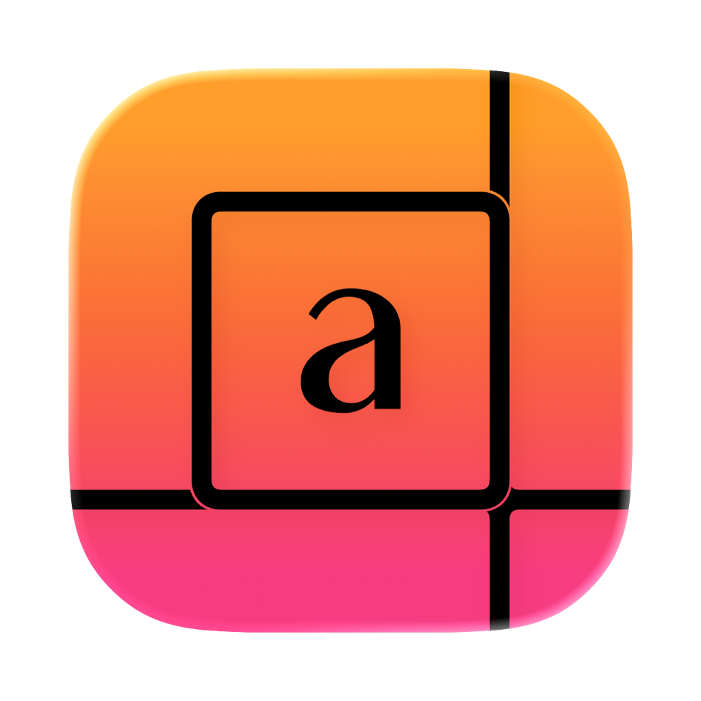
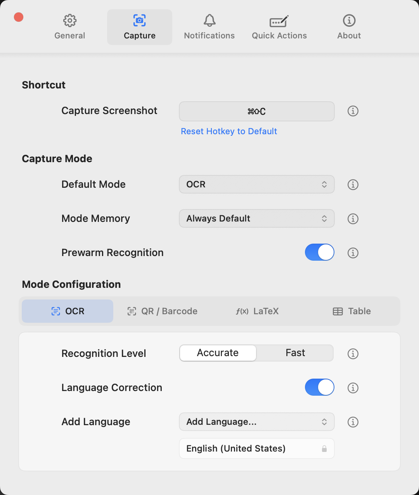

<div align="center" style="display: flex; justify-content: center; align-items: center; margin-bottom: 20px;">
  
  <div style="text-align: left;">
    <h1 align="center" style="margin: 0;">CopyShot</h1>
    <p align="center" style="margin: 0; color: gray;">Fast, transparent OCR in your Mac's menu bar</p>
  </div>
</div>

<div align="center">
<a href="https://github.com/Sayitobar/CopyShot/releases"></a>
<a href="https://github.com/Sayitobar/CopyShot/releases"></a>
<a href="https://github.com/Sayitobar/CopyShot/blob/master/LICENSE"></a>
<a href="https://github.com/Sayitobar/CopyShot"></a>
</div>

<br/>
<br/>

<p align="center">
  Capture → process → clipboard. One keystroke (⌘⇧C).
</p>

<div align="center">
  <video src="https://github.com/user-attachments/assets/a164d606-bcf8-41fa-9536-eb90fbb8c6c8" width="500" alt="CopyShot 2.0 Trailer" controls><br/>
</div>


<br/>

<p align="center">
  <strong>CopyShot is the OCR tool for people who want to control what's happening.</strong><br>
  Offers transparent preprocessing, visual inspection, and top-notch configurability.<br>
  Local recognition, no API keys and a customizable pipeline.
</p>


## Main Features

| Feature | Description |
|---------|-------------|
| **Multimodal Capture** | Standard OCR, QR/barcodes, LaTeX formulas (MFR 1.5), and table recognition. |
| **Radial Capture Menu** | Right-click and drag with cursor locking to switch capture modes on the fly. |
| **Drag-to-Capture** | Any screen area, instantly, with Retina-scaled single-frame acquisition. |
| **Multi-Monitor** | Seamless across all connected displays with active-monitor HUD placement. |
| **⌘⇧C (or your own)** | Re-bindable global hotkey via Carbon events (no Accessibility permissions needed). |
| **Vision OCR Engine** | Accurate & Fast modes, with optional language correction and custom language sets. |
| **Transparent Preprocessing** | Inspect via `Quick Actions > OCR > Inspect Capture` |
| **Quick Actions** | Mode-specific flyouts for text transforms, web links/search, table exports, math wrapping, and on-device translation.* Add your own URL templates and shell scripts. See the [usage guide](docs/USAGE.md) and [custom-action guide](docs/QUICK_ACTIONS.md). |
| **Settings Interface** | Bespoke SwiftUI layout with per-mode configurations and direct-manipulation action reordering. |
| **Resource Friendly** | Asynchronous prewarming and configurable idle eviction of the formula model. Speed and memory use depend on capture size, mode, and hardware; see [measured benchmarks](docs/TESTING.md). |
| **Privacy** | Local recognition only. No cloud or API usage. Your screen contents are processed entirely on-device and never leave your Mac. |

*\*Note: On-device translation requires macOS 15+ and a pre-installed language pack from Apple. Other Quick Actions are fully supported on macOS 14 (Sonoma)+.*

<div align="center">
  <br/>
</div>

### Multimodal Capture Modes

During a capture, right-click and drag through the radial menu to choose OCR, QR/barcode, LaTeX, or table recognition; release to select, then drag a region with the left mouse button.

- **Standard OCR**: Fast, local text recognition using Apple's Vision framework (`VNRecognizeTextRequest`) with smart reading-order assembly.
- **QR & Barcodes**: Supports all barcode and 2D matrix symbologies natively detected by Apple's `VNDetectBarcodesRequest` on your macOS version (e.g. QR, Micro QR, DataMatrix, Aztec, PDF417, EAN, UPC, Code 128/39/93, Codabar, GS1 DataBar). Formats not supported by Apple Vision (such as postal codes, Code-11, or Pharmacode) are not detected.
- **Table Recognition**:
  - *How it works*: Deterministic geometric clustering that groups Vision OCR text bounding boxes into aligned rows and columns.
  - *Output format*: Tab-Separated Values (TSV) copied to clipboard, ready to paste directly into Excel, Numbers, Google Sheets, or Markdown.
  - *Capabilities & Limitations*: Accurately captures single-line grid data (with or without visible borders, including sparse/empty cells). Wrapped multi-line text inside a single cell or merged cells (`rowspan`/`colspan`) are partitioned into separate rows/columns.
- **LaTeX Formulas**:
  - Scales the raw cropped equation capture onto a $384 \times 384$ canvas and decodes it locally via [Pix2Text MFR 1.5](https://huggingface.co/breezedeus/pix2text-mfr-1.5) using ONNX Runtime (up to 1,024 tokens).
  - *Output format*: Raw LaTeX math string. Download the model once (120 MB) from **Settings → Capture → Mode Configuration → LaTeX → MFR Model**, or follow the downloader shown on your first LaTeX capture. See [MFR 1.5 setup](docs/MFR_SETUP.md).

---

## Architecture & How It Works

CopyShot runs as an ultra-lightweight menu bar utility (`LSUIElement`) with a direct, local pipeline:

```
[Global Hotkey (⌘⇧C) or Menu Bar]
         │
         ▼
[SCScreenshotManager]          ──▶ Retina-scaled single-frame capture
         │
         ▼
[CapturePipeline & Preprocessor]
         │
   ┌─────┴───────────────────────────────┬───────────────────────────────┐
   ▼                                     ▼                               ▼
[Vision OCR / Barcode]         [Pix2Text MFR 1.5 ONNX]          [Table Spatial Clustering]
• VNRecognizeTextRequest       • Local ViT + Transformer        • Geometric text box alignment
• VNDetectBarcodesRequest      • LaTeX math expression          • TSV / CSV / Markdown export
   │                                     │                               │
   └──────────────────────────────┬──────┴───────────────────────────────┘
                                  ▼
                    ┌───────────────────────────┐
                    ▼                           ▼
        [NSPasteboard (Clipboard)]    [Floating Frosted-Glass HUD]
        (Instant pasteboard access)   (Expandable preview + Quick Actions shelf)
```

1. **Hotkey Listening**: Carbon event registration intercepts `⌘⇧C` globally without requiring Accessibility permissions.
2. **Multi-Monitor Overlay**: Full-screen transparent overlay windows open on all connected displays. Dragging cuts out the selected frame over the target text.
3. **Radial Mode Selection**: Right-click drag engages cursor locking at the call point, allowing seamless radial switching between OCR, QR, LaTeX, and Table modes.
4. **Local Recognition**: Preprocessed with CoreImage, Apple's Vision framework identifies text lines and groups them logically, while specialized engines handle barcode symbologies, table grids, or LaTeX formulas.
5. **Immediate Feedback**: The recognized text is copied to `NSPasteboard.general` while an interactive HUD with mode-specific Quick Actions appears on the captured display.

---

## Privacy
Recognition runs locally using Apple's Vision framework or the installed MFR 1.5 ONNX model. CopyShot has no capture history, analytics, or cloud recognition service. Recognized text is copied directly to the macOS clipboard.

**Actions have their own data destinations.** Web search, Wolfram Alpha, Open URL, and custom URL actions send the selected payload to the destination you choose. Custom shell scripts run through macOS's scripting service **outside CopyShot's sandbox**, with your user permissions; they can access files, use the network, and start other programs. See [Quick Actions](docs/QUICK_ACTIONS.md).

CopyShot keeps an always-on local `diagnostics.log`, capped at 1 MiB, in its Application Support folder. It records technical events, app/macOS versions, capture modes, and safe error codes; it excludes captured text/images, clipboard contents, script output, URLs, and personal file paths. Nothing is uploaded automatically. Open **Settings → About → App Data Folder** to inspect or share it with a bug report. See [troubleshooting](docs/USAGE.md#troubleshooting).

Sparkle contacts the update feed, and choosing Download fetches the optional LaTeX model from Hugging Face. These requests do not include captures or recognized text; the services receive standard request metadata, such as your IP address. Translation runs on-device on macOS 15+, but Apple may ask to download language packs on first use. Apple may collect translation API usage/performance metadata, including the app bundle ID and language pair, but not the original or translated content, as described in [Apple’s TranslationSession documentation](https://developer.apple.com/documentation/translation/translationsession). Recognition works offline after any required model or language packs are installed.

---

## Installation

> **Note:** CopyShot requires **macOS 14 (Sonoma)** or later.

1. **Download and Install:**
   Download the `.dmg` from [Releases](https://github.com/Sayitobar/CopyShot/releases), open it, and drag **CopyShot** to **Applications**. Eject the disk image, then open the installed app from Applications. CopyShot appears in the menu bar, not the Dock.

2. **Open the App:**
   - Because CopyShot is an open-source tool and not distributed through the Mac App Store, macOS Gatekeeper will block it when tried to open with a message saying *"CopyShot Not Opened, Apple could not verify CopyShot is free of malware that may harm your Mac or compromise your privacy."*.
   - **To bypass this:** Go to `System Settings > Privacy & Security`, scroll down to the bottom, and click **Open Anyway** where it mentions CopyShot was blocked. You only need to do this once.

3. **Grant Screen Recording Permission:**
   - The first time you use CopyShot (by pressing the hotkey), macOS will block it from capturing your screen.
   - Go to `System Settings > Privacy & Security > Screen & System Audio Recording`.
   - Find **CopyShot** in the list and **enable the toggle**.
   - **Important:** After granting permission, **Quit and Reopen** CopyShot for the changes to take effect.


## Running from source (for developers)
<details>
  <summary>Click to expand</summary>

If you'd like to edit, build, test, and run CopyShot yourself on macOS, here's how to get started. See [CONTRIBUTING.md](CONTRIBUTING.md) for full development guidelines.

### Prerequisites
- The app targets macOS 14+; test targets require macOS 15.5+.
- Verified with Xcode 26.2. Earlier toolchains have not been validated for this release.

### Steps
1. **Clone the Repo:**
   ```bash
   git clone https://github.com/Sayitobar/CopyShot.git
   cd CopyShot
   ```

2. **Open in Xcode:**
   Double-click `CopyShot.xcodeproj` to open it in Xcode.

3. **Build and Run:**
   In Xcode, select the `CopyShot` target and your desired build scheme (e.g., `My Mac`).
   Hit the **Run** button (play icon) or go to `Product > Run`.
   It should build and launch the app.

4. **Run Tests:**
   Run the fast unit suite via terminal:
   ```bash
   DEVELOPER_DIR=/Applications/Xcode.app/Contents/Developer \
   xcodebuild test -scheme CopyShot -destination 'platform=macOS' \
     -only-testing:CopyShotTests -skip-testing:CopyShotTests/PipelineBenchmarkTests \
     -skip-testing:CopyShotTests/OptimizationBenchmarkTests
   ```
   Benchmarks, the Settings UI smoke test, and a manual capture checklist are in [docs/TESTING.md](docs/TESTING.md).

5. **Grant Permissions:**
   The first time you run CopyShot, macOS security features will prevent it from capturing your screen. You will need to manually grant permission:
   - Go to `System Settings > Privacy & Security > Screen & System Audio Recording`.
   - Find **CopyShot** in the list of applications and **enable the toggle** next to it.
   - Quit and reopen CopyShot for the changes to take effect.

6. **Making Code Changes:**
   If you'd like to make any change to the code:
   - Save your changes.
   - Quit any running CopyShot instances.
   - Delete the given `Screen & System Audio Recording` access to all CopyShot instances if rebuilding with an updated signature.
   - Rerun the app and regrant permissions. (If doesn't work, try `Product > Perform Action > Run Without Building`)

Once it's set up, CopyShot should run & appear in your menu bar. If you're going through all this, thanks for checking it out, you probably know your way around, so feel free to tweak it.

</details>


## Ideas for future features (suggestions welcome)

<details>
  <summary>Click to expand</summary>

### Visual Inspection & Transparency
- Extend capture inspection to table cells and barcode geometries.

### OCR & Language Improvements
- Personal glossary for domain-specific vocabulary and custom corrections.
- Advanced preprocessing controls: deskew, denoise, and adaptive threshold binarization.

### Capture Options
- Capture an entire window or application frame.
- Countdown timer for timed captures.
- Handle scrolling areas for long documents and code blocks.

### Accessibility
- VoiceOver & other accessibility refinements.

</details>

## About the Project

The first version of CopyShot (v1.0.0) was live-coded with Gemini CLI. Every line, refactor, and bug-fix was done with the help of Gemini. This small experiment showed how far AI-assisted software development has come.

Now, the project is maintained with the help of a mix of AI tools and human oversight.

## License
This project is licensed under the MIT License - see the [LICENSE](LICENSE) file for details. Distributed apps also include complete [Sparkle](CopyShot/Resources/Sparkle-LICENSE.txt) and [ONNX Runtime](CopyShot/Resources/ONNXRuntime-LICENSE.txt) licenses and [third-party notices](CopyShot/Resources/ThirdPartyNotices.txt) in `Contents/Resources`.
